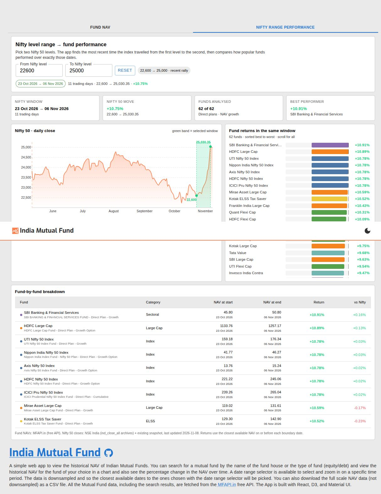

A simple web app to view the historical NAV of Indian Mutual Funds. You can search for a fund house and view the historical NAV for one of their funds in a chart and also see the percentage change in the NAV over time. A date range selector is available to select and zoom in on a specific time period. The chart was made with D3 and is complete with transitions, graidents, and tooltips. You can also download the full scale NAV data (not downsampled) as a CSV file. All the Mutual Fund data, including the search results, are fetched from the [MFAPI.in](https://www.mfapi.in/) free API. The App is built with React, D3, and Material UI.

There is also a **Nifty range performance** tab: pick two Nifty 50 levels (for example 22,600 → 25,000), and the app finds the most recent time the index travelled between them, then shows how 62 popular Direct Plan funds across Index, Large Cap, Flexi Cap, Multi Cap, Value, Mid Cap, Small Cap, Sectoral and ELSS categories performed over exactly those dates.


## Demo


## How to use
1. Type the name of the Fund house (eg: Axis, HDFC, SBI, ICICI etc.) or the type of fund (equity, debt, gold etc.) you want to search for in the search bar and then select a fund from the search results.
2. The chart will show the historical NAV of the selected fund. You can hover over the chart to see the NAV for a specific date. You can also zoom in on a specific time period by selecting a date range.
3. You can download the historical NAV data for the fund in CSV format by clicking the download button.

## Features
1. Search autocomplete for Mutual Fund names.
2. Historical NAV chart with tooltips and date range selector.
3. Color coded chart to indicate positive/negative NAV change.
4. Download historical NAV data in CSV format.
5. Nifty range performance: compare fund returns across a Nifty 50 level move (e.g. 22,600 → 25,000), with a highlighted Nifty chart, ranked return bars, and a fund-by-fund table.

## Want to run it locally?
1. Clone the repository.
2. Run `npm install` to install the dependencies.
3. Copy `.env.example` to `.env` and keep (or change) the free MFAPI.in base URL:
   ```
   VITE_MFAPI_URL=https://api.mfapi.in/mf/
   ```
4. Run `npm run dev` to start the development server.

### Nifty 50 data
The Nifty 50 daily closes used by the range-performance tab are bundled in `public/data/nifty50.json`, so the app works out of the box without any API key or CORS proxy. To refresh the snapshot:

```
npm run update:nifty            # last 3 years
npm run update:nifty -- 730     # last 730 calendar days
```

The refresh script tries Yahoo Finance first and falls back to NSE's free `ind_close_all` daily archives. It merges new rows into the existing snapshot, so a rate-limited or blocked request never deletes newer data.

### PDF report
Generate a standalone performance report for a level range:

```
python3 scripts/build-report.py
python3 scripts/build-report.py --from 22600 --to 25000 --out reports/custom.pdf
```

The PDF is rendered with headless Chrome and written to `reports/nifty-fund-performance-22600-25000.pdf`.

## Deploying
The app is a static SPA with no backend. It includes a multi-stage `Dockerfile` and an `nginx.conf` (SPA fallback, gzip, asset caching, `/healthz`), so it runs on any Docker host.

For Hetzner with Coolify, follow [COOLIFY.md](COOLIFY.md).

Quick local container test:

```
docker build -t india-mutual-fund .
docker run --rm -p 8080:80 india-mutual-fund
```

## Site link
## https://indiamf.pages.dev/